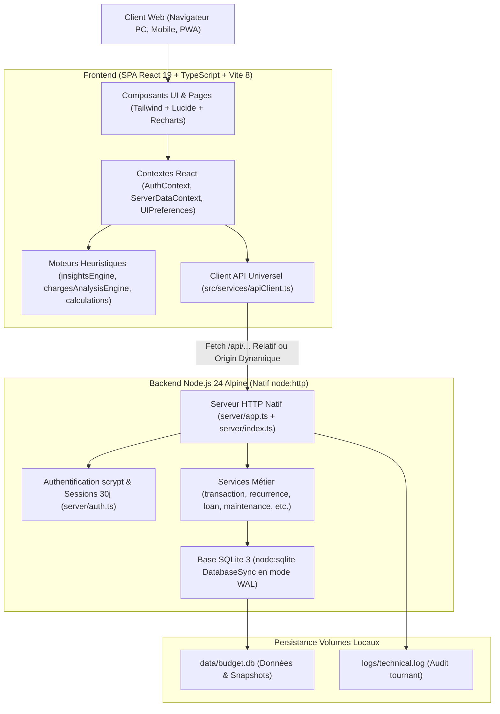

# Base de Connaissance Vivante — Personal Budget Pro (`PROJECT_KNOWLEDGE.md`)

> **Document de référence absolu du projet**  
> **Dernière mise à jour :** 2026-11-09 (Version 1.3.7)  
> **Statut QA :** 61 suites de tests Vitest, 587 tests au vert (100 % passants).

---

## 1. Règles d'Or pour les Développeurs et Agents IA

1. **Lecture obligatoire avant toute action :**  
   Tu dois impérativement lire et intégrer `PROJECT_KNOWLEDGE.md` avant d'analyser le code ou d'écrire la moindre modification.
2. **Maintenance continue de la documentation :**  
   À chaque modification de code, commit ou release, tu dois mettre à jour ce fichier en conséquence pour qu'il reste 100 % fidèle et à jour.
3. **Règle absolue de versioning (SemVer & Git Tags) :**  
   À chaque intervention, incrémente le champ `"version"` dans `package.json` (PATCH pour corrections/ajustements, MINOR pour fonctionnalités), synchronise `CHANGELOG.md` et `README.md`, recompile le front-end (`npm run build`), et associe systématiquement le commit à un tag Git annoté unique (`vX.Y.Z`). Ne JAMAIS réutiliser un tag distant existant pour ne pas corrompre le script de déploiement serveur.

---

## 2. Architecture Technique Globale

### 2.1. Frontend
- **Framework :** React 19 (SPA) avec TypeScript strict.
- **Build tool :** Vite 8 (`npm run build` génère dans `dist/`).
- **Styles & Iconographie :** Tailwind CSS, variables CSS natives, Lucide React, Recharts pour la dataviz.
- **Règles d'appels API ([`src/services/apiClient.ts`](file:///c:/Users/Yann/.gemini/antigravity-ide/scratch/personal-budget-pro/src/services/apiClient.ts)) :**
  - **Chemins relatifs stricts :** Lorsque l'application est consultée sur la même origine (ex: port 3001), les requêtes utilisent des chemins relatifs `/api/...`.
  - **Détection dynamique d'hôte :** Utilise `window.location.origin` (s'adapte immédiatement à `localhost`, l'IP LAN `192.168.0.59:3001` ou un nom de domaine distant).
  - **Auto-nettoyage :** Si une ancienne configuration `budget_server_url` pointant sur `localhost` existe en `localStorage` alors que l'utilisateur navigue sur une IP réseau, elle est automatiquement purgée.
  - **Interception 401 :** Dès qu'un appel API protégé reçoit un statut 401, l'événement `auth:unauthorized` est émis pour afficher immédiatement la modale d'authentification.

### 2.2. Backend
- **Runtime :** Node.js 24 Alpine.
- **Serveur HTTP ([`server/app.ts`](file:///c:/Users/Yann/.gemini/antigravity-ide/scratch/personal-budget-pro/server/app.ts) / [`server/index.ts`](file:///c:/Users/Yann/.gemini/antigravity-ide/scratch/personal-budget-pro/server/index.ts)) :**
  - **ZÉRO Framework tiers :** Pur serveur natif `node:http` (AUCUN Express, Fastify ou Nest).
  - **CORS dynamique :** Réflexion de l'en-tête `Origin` du client avec `Access-Control-Allow-Credentials: true`, gestion immédiate des requêtes preflight `OPTIONS` (204 No Content).
  - **Protection DoS :** Limitation stricte des payloads entrants (`readBody`) à 15 Mo max (HTTP 413).
  - **Service des fichiers statiques :** Le serveur Node sert directement le dossier `dist/` pour le frontend.

### 2.3. Base de Données
- **Moteur :** `node:sqlite` natif via `DatabaseSync` (zéro ORM lourd, requêtes SQL préparées haute performance).
- **Configuration PRAGMA :** Mode WAL (`PRAGMA journal_mode = WAL;`), `PRAGMA synchronous = NORMAL;`, `PRAGMA temp_store = MEMORY;`, cache 16 Mo (`PRAGMA cache_size = -16000;`).
- **Transactions atomiques :** Utilisation systématique du wrapper `withTransaction(db, () => { ... })` (`SAVEPOINT`) pour garantir l'intégrité ACID lors des opérations multi-tables.

---

## 3. Modèle de Données & Tables Clés

La base SQLite contient 12 tables relationnelles initialisées et migrées dans [`server/db.ts`](file:///c:/Users/Yann/.gemini/antigravity-ide/scratch/personal-budget-pro/server/db.ts) :

1. `users` : Comptes utilisateurs locaux, hash de mot de passe `scrypt`, salt, et clé de secours (`BUDGET-XXXX-XXXX-XXXX`).
2. `sessions` : Jetons d'authentification porteurs d'une validité de 30 jours (`expires_at > datetime('now')`).
3. `accounts` : Comptes bancaires (courants, livrets d'épargne, cartes différées, placements) avec solde initial et historique.
4. `categories` : Catégories budgétaires (revenus, charges fixes, variables, loisirs, santé) avec support d'archivage.
5. `income_payers` : Payeurs / sources de revenus (employeurs, organismes sociaux, clients).
6. `transactions` : Livre principal des opérations financières (réelles, récurrentes, mensualités de prêts, remboursements de soins).
   - Colonne `deleted_at INTEGER DEFAULT NULL` pour le soft-delete et l'Undo/Redo.
   - Rapprochement d'actes de santé et remboursements via `linkedId`.
7. `loans` : Prêts et emprunts (taux annuel, assurance, capital initial, capital restant dû, mensualité en cours, statut pause/archive).
8. `loan_payment_history` : Historique des changements de mensualités (crédits à paliers/modulables).
9. `loan_capital_history` : Relevés périodiques du capital restant dû pour le suivi patrimonial et l'export Excel.
10. `recurrence_templates` : Modèles d'échéances récurrentes (charges fixes, abonnements, préavis, dates de fin d'engagement / fin de promo).
11. `planned_expenses` : Dépenses prévisionnelles / Wishlist isolées du livre des comptes actifs.
12. `app_settings` : Paramètres centralisés du tableau de bord (clé/valeur : solde bancaire manuel, encours cartes).

---

## 4. Flux Critiques & Fonctionnalités Clés

### 4.1. Moteur Undo/Redo & Résilience Absolue
- **Pile d'historique :** Gérée dans [`src/contexts/ServerDataContext.tsx`](file:///c:/Users/Yann/.gemini/antigravity-ide/scratch/personal-budget-pro/src/contexts/ServerDataContext.tsx) (jusqu'à 30 actions, raccourcis clavier `Ctrl+Z` et `Ctrl+Y`).
- **Suppression d'une charge :**
  - La fonction `deleteTransaction` capture **l'intégralité de l'objet supprimé (`targetCopy`)** dans la fermeture de l'action Undo.
  - L'action Undo transmet ce snapshot à `apiClient.transactions.restore(id, targetCopy)`.
  - Côté serveur (`POST /api/transactions/:id/restore`), si la transaction existe en soft-delete, `deleted_at` est remis à `NULL`. Si la charge avait été physiquement purgée (ex: nettoyage de récurrence), le serveur la réinsère à l'identique avec son ID et ses valeurs d'origine.
  - Côté client, si l'appel `/restore` échoue avec un code HTTP, un fallback automatique exécute `apiClient.transactions.save(targetCopy)` pour recréer l'opération sans bloquer.
- **Résilience HTTP 400 :** Si une ressource est irrémédiablement introuvable, l'action obsolète est automatiquement dépilée (*while-pop*) et la boucle enchaîne sur l'action valide suivante.

### 4.2. Cycle de Vie des Charges Récurrentes & Règle Anti-Zombie
- **Génération déterministe :** Réalisée par `generateMonthlyOccurrences` dans [`server/services/recurrenceService.ts`](file:///c:/Users/Yann/.gemini/antigravity-ide/scratch/personal-budget-pro/server/services/recurrenceService.ts).
- **Anti-Zombie :**
  - Une charge récurrente passée en soft-delete ou désactivée sur un mois précis ne ressuscite JAMAIS lors des générations suivantes.
  - La suppression définitive d'un modèle récurrent purge l'ensemble des transactions liées sur tous les mois et toutes les années.
- **Filtrage mensuel strict :** Les composants [`FixedExpenses.tsx`](file:///c:/Users/Yann/.gemini/antigravity-ide/scratch/personal-budget-pro/src/pages/FixedExpenses.tsx) et [`VariableExpenses.tsx`](file:///c:/Users/Yann/.gemini/antigravity-ide/scratch/personal-budget-pro/src/pages/VariableExpenses.tsx) filtrent strictement par `exp.date.startsWith(selectedMonth)` pour ne jamais projeter indûment sur les mois futurs des charges ponctuelles orphelines de template.

### 4.3. Pilotage de Trésorerie & Règle d'Or Bancaire
- **Anti-découvert (Crash-Test) :** Calculé sur le **Solde Réel instantané** avec simulation jour par jour jusqu'au prochain revenu (priorité débits avant crédits du même jour).
- **Opportunité d'épargne :** Calculée **EXCLUSIVEMENT sur le Solde Prévisionnel net de fin de mois** (après déduction des charges engagées et du fond de roulement de sécurité).
- **Crédits à paliers :** Calcul actuariel strict du capital amorti (`calculateAmortizedCapitalServer`), plafonné au capital restant dû réel (`Math.min(capitalPart, remaining)`).

---

## 5. Environnement de Déploiement & Exploitation

### 5.1. Cible de Production
- Serveur physique **HP EliteDesk** sous **Proxmox VE** (Conteneur LXC ou VM Docker).
- Dépôt distant officiel : `https://github.com/yanfrance-droid/Budget-Perso-Pro.git`.
- Port exposé : `3001` écoutant sur `0.0.0.0` (accessible via `localhost`, IP LAN `192.168.0.59:3001` ou tunnel VPN Tailscale/WireGuard).

### 5.2. Persistance & Sauvegardes
- `./data:/app/data` : Base SQLite `budget.db`, snapshots automatiques quotidiens et sauvegardes avant migration.
- `./logs:/app/logs` : Journaux techniques tournants `technical.log`.
- **Restauration certifiée :** Le script de maintenance exécute un contrôle B-Tree préalable (`PRAGMA integrity_check;`) avant toute manipulation de base.

### 5.3. Script d'Exploitation Automatisé (`gestion-personal-budget-pro.sh`)
Placé à la racine du dépôt, ce script Bash interactif s'exécute avec les privilèges `sudo` :
- **Option 1 :** Installation vierge (clonage, initialisation volumes, build).
- **Option 2 :** Mise à jour sécurisée (sauvegarde physique SQLite `.backup` à chaud, `git fetch --tags --force`, `git pull --ff-only origin main`, reconstruction Docker sans cache et validation healthcheck).
- **Option 3 :** Réinstallation sécurisée avec sanctuarisation des dossiers `data/` et `.env`.

---

## 6. Pièges Fréquents & Gotchas à Éviter Absolument

> [!CAUTION]
> **Gotchas identifiés au cours de l'historique du projet :**
> 
> 1. **Ne pas chercher Express :** Le backend n'utilise pas Express. C'est du pur `node:http`. Les middlewares Express ou syntaxes `req.params` n'existent pas ici. Les routes sont parsées via `new URL(req.url, ...)`.
> 2. **Ne jamais réutiliser un tag Git :** Le script de déploiement distant s'appuie sur `git fetch origin --tags`. Réutiliser un tag existant provoque un rejet `[rejected] (would clobber existing tag)` et bloque le déploiement sur Proxmox.
> 3. **CORS et IPs locales :** Ne pas coder d'en-tête statique `Access-Control-Allow-Origin: *` avec des credentials. L'origine doit être reflétée dynamiquement depuis `req.headers.origin`.
> 4. **Isolation des origines `localStorage` :** Se souvenir que `localhost:3001` et `192.168.0.59:3001` ont des stockages locaux distincts. Ne jamais forcer `isAuthenticated: true` si la santé serveur échoue sans jeton.
> 5. **Projection temporelle des charges :** Ne jamais réintroduire de logique projetant automatiquement des charges sans template sur les mois futurs (`if (exp.recurrenceDay && !exp.templateId)` est banni).
> 6. **Undo de suppression :** Toujours injecter le snapshot complet de la transaction (`targetCopy`) dans l'action Undo pour permettre sa recréation en cas de purge physique en base.

---

## 7. Historique Récent des Versions Majeures

- **v1.2.2 :** Sécurité transactionnelle atomique (`withTransaction` / `SAVEPOINT`), limitation DoS payload 15 Mo, index SQLite pour accélérer les requêtes relationnelles.
- **v1.3.3 :** Résilience Undo/Redo face aux erreurs HTTP 400, suppression directe des charges fixes et variables sans bascule en statut "débité", nettoyage du filtre mensuel strict, calcul rigoureux des impayés antérieurs sur les mois futurs.
- **v1.3.4 :** Prise en charge transparente de l'accès par IP réseau locale (`192.168.0.59`), chemins relatifs `/api/...`, CORS avec `credentials: true`, interception de l'événement `auth:unauthorized` pour éviter l'état "zombie".
- **v1.3.5 :** Sauvegarde intégrale du snapshot de la charge (`targetCopy`) dans la pile Undo, endpoint `/restore` tolérant la réinsertion en base après purge physique, fallback client avec `saveTransaction`.
- **v1.3.7 :** Harmonisation post-contre-audit de la licence MIT dans `package.json` et alignement du nom physique de la table SQLite `app_settings` dans la documentation.
- **v1.3.6 :** Création de la Base de Connaissance vivante `PROJECT_KNOWLEDGE.md`, intégration des Règles d'Or dans les instructions d'agent (`AGENTS.md`).
