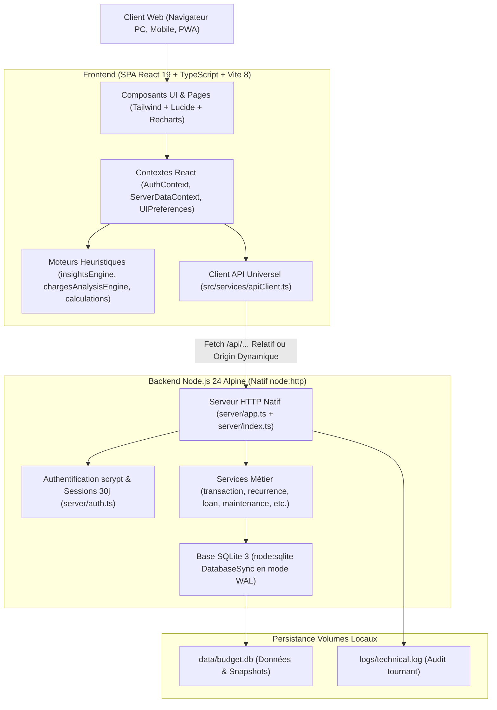

# Base de Connaissance Vivante — Personal Budget Pro (`PROJECT_KNOWLEDGE.md`)

> **Document de référence absolu du projet**  
> **Dernière mise à jour :** 2026-11-14 (Version 1.7.2 — Intégration Système tzdata et Fuseau Horaire Europe/Paris sous Docker)  
> **Statut QA :** 70 suites de tests Vitest, 675 tests au vert (100 % passants).

---

## 1. Règles d'Or pour les Développeurs et Agents IA

1. **Lecture obligatoire avant toute action :**  
   Tu dois impérativement lire et intégrer `PROJECT_KNOWLEDGE.md` avant d'analyser le code ou d'écrire la moindre modification.
2. **Maintenance continue de la documentation :**  
   À chaque modification de code, commit ou release, tu dois mettre à jour ce fichier en conséquence pour qu'il reste 100 % fidèle et à jour.
3. **Règle absolue de versioning (SemVer & Git Tags) :**  
   À chaque intervention, incrémente le champ `"version"` dans `package.json` (PATCH pour corrections/ajustements, MINOR pour fonctionnalités), synchronise `CHANGELOG.md` et `README.md`, recompile le front-end (`npm run build`), et associe systématiquement le commit à un tag Git annoté unique (`vX.Y.Z`). Ne JAMAIS réutiliser un tag distant existant pour ne pas corrompre le script de déploiement serveur.

---

## 2. Architecture Technique Globale

### 2.1. Frontend
- **Framework :** React 19 (SPA) avec TypeScript strict.
- **Build tool :** Vite 8 (`npm run build` génère dans `dist/`).
- **Styles & Iconographie :** Tailwind CSS, variables CSS natives, Lucide React, Recharts pour la dataviz.
- **Règles d'appels API ([`src/services/apiClient.ts`](file:///c:/Users/Yann/.gemini/antigravity-ide/scratch/personal-budget-pro/src/services/apiClient.ts)) :**
  - **Chemins relatifs stricts :** Lorsque l'application est consultée sur la même origine (ex: port 3001), les requêtes utilisent des chemins relatifs `/api/...`.
  - **Détection dynamique d'hôte :** Utilise `window.location.origin` (s'adapte immédiatement à `localhost`, l'IP LAN `192.168.0.59:3001` ou un nom de domaine distant).
  - **Auto-nettoyage :** Si une ancienne configuration `budget_server_url` pointant sur `localhost` existe en `localStorage` alors que l'utilisateur navigue sur une IP réseau, elle est automatiquement purgée.
  - **Interception 401 :** Dès qu'un appel API protégé reçoit un statut 401, l'événement `auth:unauthorized` est émis pour afficher immédiatement la modale d'authentification.

### 2.2. Backend
- **Runtime :** Node.js 24 Alpine.
- **Serveur HTTP ([`server/app.ts`](file:///c:/Users/Yann/.gemini/antigravity-ide/scratch/personal-budget-pro/server/app.ts) / [`server/index.ts`](file:///c:/Users/Yann/.gemini/antigravity-ide/scratch/personal-budget-pro/server/index.ts)) :**
  - **ZÉRO Framework tiers :** Pur serveur natif `node:http` (AUCUN Express, Fastify ou Nest).
  - **CORS dynamique :** Réflexion de l'en-tête `Origin` du client avec `Access-Control-Allow-Credentials: true`, gestion immédiate des requêtes preflight `OPTIONS` (204 No Content).
  - **Protection DoS :** Limitation stricte des payloads entrants (`readBody`) à 15 Mo max (HTTP 413).
  - **Service des fichiers statiques :** Le serveur Node sert directement le dossier `dist/` pour le frontend.

### 2.3. Base de Données
- **Moteur :** `node:sqlite` natif via `DatabaseSync` (zéro ORM lourd, requêtes SQL préparées haute performance).
- **Configuration PRAGMA :** Mode WAL (`PRAGMA journal_mode = WAL;`), `PRAGMA synchronous = NORMAL;`, `PRAGMA temp_store = MEMORY;`, cache 16 Mo (`PRAGMA cache_size = -16000;`).
- **Transactions atomiques :** Utilisation systématique du wrapper `withTransaction(db, () => { ... })` (`SAVEPOINT`) pour garantir l'intégrité ACID lors des opérations multi-tables.

---

## 3. Modèle de Données & Tables Clés

La base SQLite contient 12 tables relationnelles initialisées et migrées dans [`server/db.ts`](file:///c:/Users/Yann/.gemini/antigravity-ide/scratch/personal-budget-pro/server/db.ts) :

1. `users` : Comptes utilisateurs locaux, hash de mot de passe `scrypt`, salt, et clé de secours (`BUDGET-XXXX-XXXX-XXXX`).
2. `sessions` : Jetons d'authentification porteurs d'une validité de 30 jours (`expires_at > datetime('now')`).
3. `accounts` : Comptes bancaires (courants, livrets d'épargne, cartes différées, placements) avec solde initial et historique.
4. `categories` : Catégories budgétaires (revenus, charges fixes, variables, loisirs, santé) avec support d'archivage.
5. `income_payers` : Payeurs / sources de revenus (employeurs, organismes sociaux, clients).
6. `transactions` : Livre principal des opérations financières (réelles, récurrentes, mensualités de prêts, remboursements de soins).
   - Colonne `deleted_at INTEGER DEFAULT NULL` pour le soft-delete et l'Undo/Redo.
   - Rapprochement d'actes de santé et remboursements via `linkedId`.
7. `loans` : Prêts et emprunts (taux annuel, assurance, capital initial, capital restant dû, mensualité en cours, statut pause/archive).
8. `loan_payment_history` : Historique des changements de mensualités (crédits à paliers/modulables).
9. `loan_capital_history` : Relevés périodiques du capital restant dû pour le suivi patrimonial et l'export Excel.
10. `recurrence_templates` : Modèles d'échéances récurrentes (charges fixes, abonnements, préavis, dates de fin d'engagement / fin de promo, dates de fin de contrat `contract_end_date`).
11. `planned_expenses` : Dépenses prévisionnelles / Wishlist isolées du livre des comptes actifs.
12. `app_settings` : Paramètres centralisés du tableau de bord (clé/valeur : solde bancaire manuel, encours cartes).

---

## 4. Flux Critiques & Fonctionnalités Clés

### 4.1. Moteur Undo/Redo & Résilience Absolue
- **Pile d'historique :** Gérée dans [`src/contexts/ServerDataContext.tsx`](file:///c:/Users/Yann/.gemini/antigravity-ide/scratch/personal-budget-pro/src/contexts/ServerDataContext.tsx) (jusqu'à 30 actions, raccourcis clavier `Ctrl+Z` et `Ctrl+Y`).
- **Suppression d'une charge :**
  - La fonction `deleteTransaction` capture **l'intégralité de l'objet supprimé (`targetCopy`)** dans la fermeture de l'action Undo.
  - L'action Undo transmet ce snapshot à `apiClient.transactions.restore(id, targetCopy)`.
  - Côté serveur (`POST /api/transactions/:id/restore`), si la transaction existe en soft-delete, `deleted_at` est remis à `NULL`. Si la charge avait été physiquement purgée (ex: nettoyage de récurrence), le serveur la réinsère à l'identique avec son ID et ses valeurs d'origine.
  - Côté client, si l'appel `/restore` échoue avec un code HTTP, un fallback automatique exécute `apiClient.transactions.save(targetCopy)` pour recréer l'opération sans bloquer.
- **Résilience HTTP 400 :** Si une ressource est irrémédiablement introuvable, l'action obsolète est automatiquement dépilée (*while-pop*) et la boucle enchaîne sur l'action valide suivante.

### 4.2. Cycle de Vie des Charges Récurrentes, Verrouillage Temporel & Watchdog Universel
- **Génération déterministe & Verrouillage strict du passé :**
  - Réalisée par `generateMonthlyOccurrences` dans [`server/services/recurrenceService.ts`](file:///c:/Users/Yann/.gemini/antigravity-ide/scratch/personal-budget-pro/server/services/recurrenceService.ts).
  - **Verrouillage absolu du passé (< mois civil courant) :** Toute tentative de générer ou synchroniser des transactions sur un mois antérieur au mois en cours (`targetMonth < currentMonth`, ex: avant `2026-11`) est strictement bloquée côté backend (`return 0`).
  - **Consultation passée 100 % lecture seule :** Les 5 pages clientes (`Dashboard`, `FixedExpenses`, `VariableExpenses`, `Incomes`, `Savings`) neutralisent leurs `useEffect` de synchronisation dès lors que `selectedMonth < currentMonth`.
  - La navigation vers les mois antérieurs ne peut donc en aucun cas créer de charges prévisionnelles parasites ou fausser les impayés antérieurs.
- **Watchdog d'Intégrité Universel & Fidélité Historique (`contractIntegrityEngine.ts`) :**
  - **Fidélité historique multi-rubriques (Fixes, Variables, Revenus) :** Lorsqu'un contrat est résilié au mois $M$, son échéance passée scellée ($M-1$) conserve son statut et voit son template détaché (`templateId = null`). Le Watchdog compte fidèlement ces échéances historiques (`totalExpected++` et `totalFound++`), affichant par exemple `23/23` en Octobre et `22/22` en Novembre sans faux positif de surnombre.
  - **Exclusion stricte des ponctuels :** Les opérations purement ponctuelles (ex: *Gazoil 32,76 €*, *Virement Épargne 1 860,58 €* sans `templateId` ni `recurrenceDay`) sont totalement ignorées du décompte contractuel.
  - **Détection hybride des doublons & Affichage nominatif :** Détecte les doublons par composantes connexes soit par `templateId` partagé, soit par triplet (libellé normalisé + montant absolu identique + même date/jour). L'interface affiche nominativement chaque doublon (`⚠️ Doublon : {label} ({amount} €) — {count} occurrences le {dates}`).
- **Résiliation Atomique en 1 Clic (Choix 2) :**
  - Lorsque l'utilisateur résilie un contrat à partir du mois sélectionné $M$ (`deleteRecurrenceTemplate(db, id, fromDate)`) :
    * Les occurrences futures prévisionnelles (`date >= fromDate AND status = 'planned'`) sont physiquement purgées (`DELETE`).
    * La transaction du mois sélectionné $M$ (même si elle est déjà pointée `cleared` ou `pending`) est passée en soft-delete (`deleted_at = now`, `templateId = NULL`) afin de disparaître immédiatement de l'écran en un seul clic, sans obliger à un second clic de suppression.
    * Le passé strict (`date < fromDate`) est sanctuarisé avec `deleted_at = NULL` et détaché (`templateId = NULL`).
    * Le snapshot d'Undo capture l'ensemble de ces transactions : un seul clic sur "Annuler" restaure l'ensemble à l'identique (template réactivé, transaction de $M$ réactivée avec son statut exact `cleared`/`pending`, occurrences futures repeuplées).
- **Anti-Zombie :**
  - Une charge récurrente passée en soft-delete ou désactivée sur un mois précis ne ressuscite JAMAIS lors des générations suivantes.
  - La suppression définitive d'un modèle récurrent purge l'ensemble des transactions liées sur tous les mois et toutes les années.
- **Filtrage mensuel strict :** Les composants [`FixedExpenses.tsx`](file:///c:/Users/Yann/.gemini/antigravity-ide/scratch/personal-budget-pro/src/pages/FixedExpenses.tsx) et [`VariableExpenses.tsx`](file:///c:/Users/Yann/.gemini/antigravity-ide/scratch/personal-budget-pro/src/pages/VariableExpenses.tsx) filtrent strictement par `exp.date.startsWith(selectedMonth)` pour ne jamais projeter indûment sur les mois futurs des charges ponctuelles orphelines de template.

### 4.3. Pilotage de Trésorerie, Crédits & Règle d'Or Bancaire
- **Anti-découvert (Crash-Test) :** Calculé sur le **Solde Réel instantané** avec simulation jour par jour jusqu'au prochain revenu (priorité débits avant crédits du même jour).
- **Opportunité d'épargne :** Calculée **EXCLUSIVEMENT sur le Solde Prévisionnel net de fin de mois** (après déduction des charges engagées et du fond de roulement de sécurité).
- **Crédits & Amortissement Actuariel (Paliers 1, 2 & 3) :**
  - **Cohérence arithmétique des compteurs :** Décompte des échéances historiques net d'ajustement (`effectivePrepaid = Math.max(0, prepaid + adjustment)` dans [`Loans.tsx`](file:///c:/Users/Yann/.gemini/antigravity-ide/scratch/personal-budget-pro/src/pages/Loans.tsx)) pour garantir la concordance stricte entre total affiché et détail entre parenthèses.
  - **Compte à rebours contractuel :** Badge d'en-tête de prêt basé en priorité sur `durationMonths - clearedPayments` et la date de fin contractuelle (`loan.endDate`).
  - **Simulation actuarielle dynamique (`simStartMonth`) :** Si l'échéance du mois en cours est déjà au statut `cleared` (donc déjà déduite du capital restant dû en base), `estimateLoanPayoffClient` démarre la simulation d'amortissement résiduelle à **M+1**, éliminant tout double comptage du mois déjà prélevé.
  - **Coût caché & Perte sèche résiduelle :** Cumul des intérêts et cotisations d'assurance restants jusqu'au terme du crédit, dissocié du capital amorti utile.
  - **Monitoring HCSF sur Dashboard & Harmonisation Loans.tsx :** Taux d'endettement brut du foyer avec pastille d'alerte HCSF (`Sain (< 30 %)`, `Modéré (30-33 %)`, `Limite HCSF (33-35 %)`, `Élevé (35-45 %)`, `Critique (≥ 45 %)`), découpe de l'effort Immo patrimonial vs Conso fractionné, et passif global du foyer (capital restant dû + facture réelle).
  - **Sentinelles d'endettement automatisées (`insightsEngine.ts`) :**
    * `auditConsumerDebtVulnerability` : warning si les crédits conso dépassent 15 % des revenus prévus.
    * `auditLoanFreedomCountdown` : notification (success/info) à ≤ 3 mensualités de l'échéance chiffrant le cash-flow mensuel définitivement libéré.
    * `auditUpcomingLoanTiers` : alerte anticipée sous 60 jours en cas de hausse ou baisse de mensualité programmée sur un prêt à paliers.
  - **Trajectoire d'Extinction & Libération du Cash-Flow (Palier 3) :**
    * **Découpage ergonomique par onglets internes :** Dans [`Loans.tsx`](file:///c:/Users/Yann/.gemini/antigravity-ide/scratch/personal-budget-pro/src/pages/Loans.tsx), gestion d'état `LoanTab = 'active' | 'timeline' | 'archived'` préservant l'étanchéité des formulaires, filtres et flux opérationnels.
    * **Spécification du composant [`LoanReleaseTimeline.tsx`](file:///c:/Users/Yann/.gemini/antigravity-ide/scratch/personal-budget-pro/src/components/loans/LoanReleaseTimeline.tsx) :**
      - Moteur d'ordonnancement `computeReleaseMilestones(loans, monthlyIncomes, loanPayments, currentMonth)` triant rigoureusement chaque prêt actif par date d'extinction contractuelle (`endDate`) ou actuarielle (`estimateLoanPayoffClient`).
      - Détection des paliers simultanés et regroupement logique des prêts éteints le même mois.
      - Calcul du gain mensuel net libéré pour chaque crédit (`monthlyPayment`).
      - Cumul progressif du cash-flow restitué au foyer (`+XX,XX €/mois`) affiché en continu avec mise en valeur de l'effet « boule de neige ».
      - Projection en temps réel du taux d'endettement résiduel après chaque extinction de dette, jusqu'au « Grand Chelem » final (0,0 % d'endettement, 100 % des mensualités restituées).
      - Respect strict de l'échelle d'alerte HCSF harmonisée (`Sain < 30 %`, `Modéré 30-33 %`, `Limite HCSF 33-35 %`, `Élevé 35-45 %`, `Critique ≥ 45 %`).

---

### 4.4. Moteur d'Intégrité DB Doctor & Safe Healer (Diagnostic Forensic & Réparations Transactionnelles)

- **Sécurisation du Boot Système (Safe Boot) :**
  - Éradication totale des mutations silencieuses au démarrage (`server/db.ts`) : retrait de l'appel automatique à `repairOrphans(db)` dans `runStartupMaintenance` (signature `{ repaired: 0, purged }` préservée pour rétrocompatibilité).
  - Retrait de l'appel automatique à `rehabilitateOrphanRecurrentTransactions(db)` dans `runMigrations`. Le démarrage et les migrations sont 100 % passifs, non-destructifs et déterministes.
- **Moteur DB Doctor (`server/services/dbDoctorService.ts`) :**
  - **100 % Lecture Seule :** Zéro écriture, zéro effet de bord, analyse complète sans mutation via 13 requêtes SQL forensic (`ANOM-01` à `ANOM-13`) et vérification B-Tree native (`PRAGMA quick_check(1)`).
  - **Ventilation Dynamique en Temps Réel :** Calcul SQL direct des compteurs de `recurrence_templates` (23 charges fixes actives, 4 revenus récurrents, 1 dépense variable active, 2 contrats inactifs/désactivés) sans aucune valeur codée en dur.
  - **Exposition Sécurisée :** Route `GET /api/maintenance/doctor` avec authentification et support de l'audit temporel contextuel (`?referenceMonth=YYYY-MM`).
- **Moteur DB Healer (`server/services/dbHealerService.ts`) :**
  - **Protocole Tripartite & Sauvegarde Préalable :**
    * Mode **Dry-Run 100 % passif** (`POST /api/maintenance/doctor/dry-run`) : exécuté au sein d'un Savepoint SQLite éphémère (`SAVEPOINT sp_healer_preview`) immédiatement annulé par `ROLLBACK TO` pour simuler les mutations au bit près sans modifier un seul octet en base.
    * Mode **Application Chirurgicale** (`POST /api/maintenance/healer`) : création préalable obligatoire d'une copie physique SQLite conforme (`VACUUM INTO`), exécution sous transaction isolée (`SAVEPOINT sp_healer_apply`) avec activation stricte des clés étrangères (`PRAGMA foreign_keys = ON;`), validation d'intégrité relationnelle (`PRAGMA foreign_key_check`), et contre-audit post-réparation certifiant l'éradication des anomalies avant commit final.
  - **Politiques de Traitement & Arbitrage Assisté :**
    * *ANOM-03 (Mensualité de prêt orpheline) :* Rattachement ciblé à un prêt valide (`userParameters.targetLoanId`) ou dissociation propre (`linkedId = NULL`).
    * *ANOM-04 & ANOM-05 (Virement sans destinataire & Transaction sans compte) :* **Zéro auto-réassignation aveugle**. Exige impérativement un `targetAccountId` explicite choisi par l'utilisateur.
    * *ANOM-08 (Transaction liée à un contrat supprimé) :* Détachement propre (`templateId = NULL`) sans altération des charges variables désactivées légitimes.
    * *ANOM-09 (Doublon actif de template dans le même mois) :* Politique anti-extinction totale avec élection d'un gagnant unique selon la hiérarchie stricte d'états (`cleared` > `pending` > `isCustomized` > `planned`) et purge douce uniquement des excédents au statut `planned`.
    * *ANOM-13 (Dépenses prévues dans un mois passé clos) :* Arbitrage explicite guidé entre pointage en payé (`clear`) ou mise à la corbeille douce (`trash`).
- **Interface Utilisateur Dédiée (`src/pages/Settings.tsx`) :**
  - **Console Proactive & Permanente (v1.7.0) :** Dès l'ouverture de la carte « Santé & Optimisation du fichier SQLite », affichage permanent d'un cartouche d'information rassurant expliquant les rôles de DB Doctor et DB Healer, éliminant tout sentiment de "fonction fantôme ou cachée".
  - **Distinction Pédagogique VACUUM vs DB Doctor :** Rappel direct et visible dans l'interface et le manuel : `VACUUM` opère au niveau physique (défragmentation des pages B-Tree SQLite et vidage du WAL), tandis que `DB Doctor` opère au niveau logique (vérité comptable et relations de données).
  - **Indicateur d'État DB Healer en Santé Nominale :** Lorsque la base est saine (`totalAnomalies === 0`), affichage simultané du badge émeraude Doctor (« Base 100 % saine et intègre ») et du badge bleu océan Healer (« En veille active / Au repos — Aucune réparation requise »), attestant de sa disponibilité continue.
  - Cartouche KPI des métriques globales et répartition dynamique des 30 contrats (23 fixes, 4 revenus, 1 variable active, 2 inactifs).
  - Modale Dry-Run interactive affichant la table comparative des diffs (`Table`, `ID`, `Champ`, `Avant`, `Après`, `Action`) avant toute confirmation de l'utilisateur.
  - **Guide Opérationnel In-App Complet :** Intégration dans la section Aide (`activeSection === 'help'`) du protocole de réparation en 3 étapes (Audit passif -> Dry-Run -> Sauvegarde préalable `VACUUM INTO` atomique) et du référentiel détaillé des 13 sondes forensiques (`ANOM-01` à `ANOM-13`).
  - Rafraîchissement automatique des états (`serverData?.refreshAll()`) et ré-audit instantané après réparation.

---

## 5. Environnement de Déploiement & Exploitation

### 5.1. Cible de Production
- Serveur physique **HP EliteDesk** sous **Proxmox VE** (Conteneur LXC ou VM Docker).
- Dépôt distant officiel : `https://github.com/yanfrance-droid/Budget-Perso-Pro.git`.
- Port exposé : `3001` écoutant sur `0.0.0.0` (accessible via `localhost`, IP LAN `192.168.0.59:3001` ou tunnel VPN Tailscale/WireGuard).

### 5.2. Persistance & Sauvegardes
- `./data:/app/data` : Base SQLite `budget.db`, snapshots automatiques quotidiens et sauvegardes avant migration.
- `./logs:/app/logs` : Journaux techniques tournants `technical.log`.
- **Restauration certifiée :** Le script de maintenance exécute un contrôle B-Tree préalable (`PRAGMA integrity_check;`) avant toute manipulation de base.

### 5.3. Script d'Exploitation Automatisé (`gestion-personal-budget-pro.sh`)
Placé à la racine du dépôt, ce script Bash interactif s'exécute avec les privilèges `sudo` :
- **Option 1 :** Installation vierge (clonage, initialisation volumes, build).
- **Option 2 :** Mise à jour sécurisée (sauvegarde physique SQLite `.backup` à chaud, `git fetch --tags --force`, `git pull --ff-only origin main`, reconstruction Docker sans cache et validation healthcheck).
- **Option 3 :** Réinstallation sécurisée avec sanctuarisation des dossiers `data/` et `.env`.

### 5.4. Automatisation Documentaire & Captures Headless (`scripts/`)
- **Base Démo Étanche (`scripts/seed-demo.ts`) :** Génère une base SQLite 100 % anonymisée dans `data/budget.demo.db` (sanctuarisant la vraie base `data/budget.db`) avec des volumes équilibrés (3 comptes, 3 revenus, 4 crédits échelonnés de 2026 à 2044, 2 dossiers de soins santé et 45 transactions).
- **Campagne de Captures Headless (`scripts/generate-screenshots.ts`) :** Démarre un serveur éphémère sur le port 3099, pilote Puppeteer avec wait strategies strictes (`networkidle0`, `document.fonts.ready`, stabilisation Recharts SVG + délai de transition CSS), et génère la galerie officielle :
  * `docs/screenshots/desktop/` : 14 captures haute définition (1920x1080 @2x).
  * `docs/screenshots/mobile/` : 7 captures iPhone 14 Pro (393x852 @3x).

---

## 6. Pièges Fréquents & Gotchas à Éviter Absolument

> [!CAUTION]
> **Gotchas identifiés au cours de l'historique du projet :**
> 
> 1. **Ne pas chercher Express :** Le backend n'utilise pas Express. C'est du pur `node:http`. Les middlewares Express ou syntaxes `req.params` n'existent pas ici. Les routes sont parsées via `new URL(req.url, ...)`.
> 2. **Ne jamais réutiliser un tag Git :** Le script de déploiement distant s'appuie sur `git fetch origin --tags`. Réutiliser un tag existant provoque un rejet `[rejected] (would clobber existing tag)` et bloque le déploiement sur Proxmox.
> 3. **CORS et IPs locales :** Ne pas coder d'en-tête statique `Access-Control-Allow-Origin: *` avec des credentials. L'origine doit être reflétée dynamiquement depuis `req.headers.origin`.
> 4. **Isolation des origines `localStorage` :** Se souvenir que `localhost:3001` et `192.168.0.59:3001` ont des stockages locaux distincts. Ne jamais forcer `isAuthenticated: true` si la santé serveur échoue sans jeton.
> 5. **Projection temporelle des charges :** Ne jamais réintroduire de logique projetant automatiquement des charges sans template sur les mois futurs (`if (exp.recurrenceDay && !exp.templateId)` est banni).
> 6. **Undo de suppression :** Toujours injecter le snapshot complet de la transaction (`targetCopy`) dans l'action Undo pour permettre sa recréation en cas de purge physique en base.
> 7. **Assiette du matelas de sécurité / précaution :** L'assiette mensuelle pour calculer le nombre de mois de couverture en épargne de précaution ne doit en aucun cas inclure les flux d'épargne volontaire (virements vers l'épargne). Elle repose exclusivement sur les dépenses contraintes pures (fixes, variables de subsistance, crédits).
> 8. **Suivi des fins de contrat et tacite reconduction :** La date d'échéance `contract_end_date` est stockée sur `recurrence_templates`. La sentinelle `auditContractExpirations` surveille les 30 jours précédant l'expiration (et les contrats déjà échus) pour éviter les reconductions tacites automatiques.
> 9. **Immuabilité stricte du passé (< mois courant) :** `syncRollingHorizon` ne doit jamais tenter de régénérer ou repeupler des mois échus (`pastMonths = 0` imposé et `startOffset = Math.max(0, -Math.max(0, pastMonths))`). Le passé est sanctuarisé pour éviter d'insérer des opérations prévisionnelles dans des périodes déjà clôturées.
> 10. **Préservation du statut lors du Undo / Restauration :** Lors de la restauration d'une transaction via l'Undo ou `/api/transactions/:id/restore`, le statut réel d'origine (`cleared`, `pending`, etc.) doit être transmis et restauré sans jamais être écrasé par `'planned'`. De plus, la synchronisation post-restauration ne doit s'exécuter qu'à partir de $M+1$ (`nextMonth`) pour ne pas altérer le mois en cours $M$.
> 11. **Dédoublement d'historique (Undo/Redo) :** La suppression d'un contrat récurrent (`deleteRecurrenceTemplate`) prenant déjà en charge la purge des occurrences associées et l'enregistrement de l'action dans l'historique, il ne faut jamais appeler en doublon `deleteTransaction` pour la même ligne.
> 13. **Safe Boot absolu (Zéro mutation silencieuse) :** Ne JAMAIS réintroduire de réparation automatique ou de réhabilitation au démarrage (`runStartupMaintenance`, `runMigrations`). Toute correction de base doit être diagnostiquée par le DB Doctor et validée explicitement par l'utilisateur via le DB Healer.
> 14. **Sanctuarisation des modèles de récurrence désactivés :** Les 30 modèles de récurrence (incluant les charges variables désactivées comme *Axa scolaire* et *Axa trotinette*) sont des contrats légitimes. Le Doctor et le Healer ne doivent JAMAIS purger ou altérer les transactions rattachées à des modèles désactivés.
> 15. **Interdiction de réassignation aveugle :** Ne jamais coder de réassignation automatique d'une transaction sans compte valide vers un compte par défaut (`ANOM-04`, `ANOM-05`). Un choix explicite de compte cible par l'utilisateur est strictement requis pour préserver l'intégrité comptable.
> 12. **Suppression atomique en 1 clic sur résiliation (Choix 2) :** Lorsqu'un contrat est résilié à partir du mois sélectionné $M$, l'occurrence du mois $M$ doit disparaître immédiatement de l'écran en un seul clic (via soft-delete `deleted_at = now, templateId = NULL` si déjà `cleared`/`pending`). Cela évite le bug du double-clic et garantit qu'une seule action Undo est générée par suppression.

---

## 7. Historique Récent des Versions Majeures

- **v1.7.2 :** Intégration Système `tzdata` et Fuseau Horaire `Europe/Paris` sous Docker (`Dockerfile`, `docker-compose.yml`, `.env.example`) :
  - *Intégration du paquet `tzdata` dans l'image Alpine Linux (`Dockerfile`) :* Ajout de `tzdata` dans la couche `runner` de `node:24-alpine`. Alpine Linux et sa `musl libc` ne disposant pas nativement des définitions de fuseaux horaires IANA, la présence de `tzdata` est indispensable pour résoudre `Europe/Paris` et éviter la retombée silencieuse en UTC.
  - *Définition native de la variable d'environnement `TZ` :* Définition de `ENV TZ=Europe/Paris` dans le `Dockerfile` et transmission déclarative de `TZ=${TZ:-Europe/Paris}` dans `docker-compose.yml`.
  - *Éradication définitive du décalage horaire des logs :* L'horodatage interne généré par `getLocalTimestamp()` dans `server/services/loggerService.ts` et les journaux de conteneur sont désormais strictement calés sur l'heure locale française (CET UTC+1 / CEST UTC+2) à chaque reconstruction ou mise à jour de conteneur.
  - *Documentation & Stabilité :* Ajout de la variable `TZ=Europe/Paris` dans `.env.example`, compilation frontend `npm run build` validée et persistance des 496 opérations SQLite intactes.

- **v1.7.1 :** Harmonisation du KPI « Total des charges obligatoires », Ventilation Dynamique et Cohérence Inter-Pages (`src/pages/Dashboard.tsx`, `src/pages/Incomes.tsx`, `src/pages/Incomes.test.tsx`) :
  - *Ventilation dynamique explicite sur le Dashboard (`src/pages/Dashboard.tsx`) :* Remplacement du sous-titre générique et obsolète (« Fixes, variables, crédit, épargne ») de la carte KPI « Total des charges obligatoires » par la décomposition dynamique en temps réel des trois composantes réelles du calcul : `
Fixes : {formatCurrency(chargesMois.fixed)} • Crédits : {formatCurrency(chargesMois.loan)} • Variables : {formatCurrency(chargesMois.variable)}
`, apportant une transparence comptable totale et éliminant toute fausse mention d'épargne.
  - *Harmonisation inter-pages avec l'onglet Revenus (`src/pages/Incomes.tsx`) :* Alignement strict du calcul de `totalObligatoires` sur la formule du Dashboard (`roundCurrency(fixed + variable + totalLoanPlanned)`), en excluant définitivement les flux d'épargne volontaire (`transfer`) qui gonflaient indûment les charges obligatoires à 4 174,98 € au lieu des 2 314,40 € de charges réelles du foyer.
  - *Reste à vivre brut théorique fiabilisé :* Synchronisation de la déduction dans la page Revenus (`totalPlanned - totalObligatoires`) garantissant une parfaite cohérence entre la trésorerie projetée et le livre des charges.
  - *Non-régression & Tests :* Validation des 70 suites de tests Vitest (675 tests au vert), actualisation conforme de `Incomes.test.tsx` et persistance des 496 opérations SQLite intactes.

- **v1.7.0 :** Console Proactive DB Doctor & Safe Healer, Guide Opérationnel In-App et Documentation Exhaustive (`src/pages/Settings.tsx`, `README.md`, `CHANGELOG.md`) :
  - *Console d'Intégrité Permanente et Proactive :* Fin de la perception de "fonction fantôme ou cachée" ; un cartouche d'information pédagogique est visible en permanence dès l'accès à la carte « Santé & Optimisation du fichier SQLite », expliquant le rôle de DB Doctor (diagnostic 100 % passif en lecture seule) et de Safe Healer (moteur chirurgical avec Dry-Run et sauvegarde atomique).
  - *Différenciation VACUUM vs DB Doctor :* Explication limpide intégrée directement sous les boutons et dans le manuel : `VACUUM` traite le niveau physique (défragmentation des pages B-Tree du fichier SQLite sur le disque et vidage du WAL), alors que `DB Doctor` traite le niveau logique (vérité comptable et relations entre transactions, comptes, prêts et contrats).
  - *Indicateur d'État DB Healer en Régime Nominal :* Lorsque la base est saine (`totalAnomalies === 0`), affichage simultané du statut vert émeraude du DB Doctor et du statut bleu océan du DB Healer (« En veille active / Au repos — Aucune réparation requise »), confirmant que le moteur reste armé et prêt à intervenir.
  - *Guide Opérationnel Complet In-App (`activeSection === 'help'`) :* Ajout d'une section dédiée détaillant le protocole de réparation en 3 étapes (Audit passif -> Simulation à blanc Dry-Run par Savepoint éphémère avec tableau de diff -> Sauvegarde physique préalable atomique `VACUUM INTO` dans `data/backups/auto/` et application sous contrôle de clés étrangères) et le référentiel des 13 sondes forensiques (`ANOM-01` à `ANOM-13`).
  - *Enrichissement de `README.md` :* Ajout d'une section entière (Section 4) dédiée à l'intégrité des données, aux mécanismes de diagnostic et aux garanties de l'architecture Safe Boot.
  - *Non-régression & Tests :* Validation des 70 suites de tests Vitest (675 tests au vert), tests dédiés `Settings.test.tsx` passants et persistance des 496 opérations SQLite.

- **v1.6.3 :** Bandeaux pleins haute visibilité pour les 4 cartes « Serveur & Synchro », Navigation Solid Badge et En-têtes HTTP anti-cache mobile (`src/pages/Settings.tsx` & `server/app.ts`) :
  - *Bandeaux de cartes pleins et contrastés :* Fin des teintes pâles translucides ; chaque en-tête de carte est désormais un bandeau plein et éclatant avec texte et icônes blanc pur (Bleu roi `#1d4ed8`, Vert émeraude `#059669`, Bleu océan `#0284c7`, Violet `#7c3aed`), offrant une visibilité immédiate et sans équivoque sur PC et smartphone.
  - *Navigation supérieure en Solid Badge :* L'onglet sélectionné passe en couleur pleine saturée avec texte blanc pur `#ffffff` et ombre portée dédiée, tandis que les onglets inactifs restent en gris doux clair `#f1f5f9` avec leur icône thématique colorée.
  - *En-têtes HTTP Anti-Cache Mobile (`server/app.ts`) :* Envoi systématique de `Cache-Control: no-cache, no-store, must-revalidate` sur les fichiers `.html`, forçant Safari iOS et Chrome Android à télécharger instantanément le bundle Vite le plus récent sans nécessiter de purge manuelle de l'historique mobile.
  - *Non-régression :* Validation stricte des 70 suites de tests Vitest (675 tests au vert), persistance des 496 opérations SQLite.

- **v1.6.2 :** Bandeaux d'en-tête teintés doux pour les 4 cartes « Serveur & Synchro » et boutons de navigation supérieure ergonomiques (`src/pages/Settings.tsx`) :
  - *Bandeaux d'en-tête de carte à surbrillance douce :* Chaque carte possède désormais un bandeau d'en-tête dédié teinté d'un pastel doux (8 % d'opacité) avec liseré coordonné et titre gras contrasté (`#1d4ed8` en bleu pour le serveur central, `#047857` en vert pour Proxmox, `#0284c7` en bleu océan pour la santé SQLite, et `#6d28d9` en violet pour les logs).
  - *Refonte des onglets de navigation supérieure :* Élimination de l'effet fil de fer vide ; les boutons inactifs bénéficient d'un fond accueillant et net, et l'onglet actif s'illumine d'un fond pastel thématique, d'une bordure fine et d'un texte franc lisible sans agressivité.
  - *Harmonisation iconographique :* Ajout de l'icône `Tag` sur le bouton *Catégories de budget*.
  - *Non-régression & Tests :* 70 suites de tests Vitest (675 tests au vert), build 100 % réussi.

- **v1.6.1 :** Mise en valeur visuelle et ergonomique de l'onglet « Serveur & Synchro » (`src/pages/Settings.tsx`) :
  - *Découpage en 4 cartes distinctes :* Fin du bloc monolithique au profit de 4 conteneurs indépendants dotés d'accents doux et d'icônes sur pastilles colorées (`Base centralisée SQLite & Accès distant VPN` en bleu `#3b82f6`, `Ressources système & Réseau Proxmox` en vert `#10b981`, `Santé & Optimisation du fichier SQLite` en bleu ciel `#0284c7`, et `Journal des événements techniques (Logs)` en violet `#8b5cf6`).
  - *Boutons d'action à forte visibilité :* Bouton **Audit Intégrité (DB Doctor)** en vert émeraude vibrant (`#059669`) et bouton **Optimiser & Compacter (VACUUM)** en bleu océan dynamique (`#0284c7`), offrant un contraste optimal et une différenciation visuelle immédiate.
  - *Non-régression & Accessibilité :* Conservation intégrale de la structure sémantique ARIA, de l'état de persistance SQLite (496 transactions) et validation des 70 suites de tests Vitest (675 tests au vert).

- **v1.6.0 :** Moteur d'Intégrité DB Doctor & Safe Healer, Safe Boot & Réparations Transactionnelles Sécurisées :
  - *Safe Boot (Démarrage 100 % passif) :* Neutralisation définitive des réparations silencieuses au boot et lors des migrations (`repairOrphans` et `rehabilitateOrphanRecurrentTransactions` retirés de `runStartupMaintenance` et `runMigrations`).
  - *Moteur DB Doctor 100 % Lecture Seule (`server/services/dbDoctorService.ts`, `GET /api/maintenance/doctor`) :* Audit forensic B-Tree (`PRAGMA quick_check(1)`) et détection des 13 anomalies structurelles réelles (`ANOM-01` à `ANOM-13`), métriques en temps réel avec ventilation SQL dynamique des 30 contrats (23 fixes, 4 revenus, 1 variable active, 2 inactifs).
  - *Moteur DB Healer Transactionnel (`server/services/dbHealerService.ts`, `POST /api/maintenance/doctor/dry-run`, `POST /api/maintenance/healer`) :* Mode simulation Dry-Run 100 % passif via Savepoint éphémère annulé immédiatement, mode application avec sauvegarde physique préalable atomique (`VACUUM INTO`), validation des contraintes de clés étrangères (`PRAGMA foreign_key_check`), et contre-audit post-application certifiant l'assainissement complet de la base.
  - *Interface Utilisateur Moderne (`src/pages/Settings.tsx`) :* Rubrique Maintenance avec badge d'intégrité, métriques dynamiques sans valeurs en dur, arbitrages guidés (comptes, prêts, soldage des échéances passées closes `ANOM-13`), et modale interactive de restitution du diff avant validation.
  - *Couverture QA Exhaustive :* 70 suites de tests Vitest, 675 tests au vert (100 % passants).

- **v1.5.0 :** Implémentation du Watchdog d'Intégrité Universel des Contrats & Récurrences, verrouillage strict du passé en lecture seule et résilience Undo/Redo atomique :
  - *Verrouillage Temporel du Passé (< mois civil courant) :* Neutralisation des `useEffect` clients lors de la consultation des mois antérieurs et verrou strict côté backend (`generateMonthlyOccurrences`, `syncRollingHorizon`) bloquant toute création de charges prévisionnelles parasites dans le passé et évitant l'apparition de faux impayés antérieurs.
  - *Watchdog d'Intégrité Universel & Fidélité Historique (`contractIntegrityEngine.ts`, `ContractIntegrityBanner.tsx`, `IntegritySectionBadge.tsx`) :* Audit granulaire et arbitrable couvrant les 3 rubriques (Fixes, Variables, Revenus), fidélité historique du dénominateur (`23/23` en Octobre même après résiliation d'un contrat en Novembre), exclusion stricte des dépenses et revenus ponctuels sans récurrence, détection hybride des doublons (par `templateId` ou libellé normalisé + montant + date) et affichage nominatif détaillé dans l'interface.
  - *Suppression Atomique en 1 Clic sur Résiliation :* Dans `deleteRecurrenceTemplate(db, id, fromDate)`, les occurrences prévisionnelles futures sont purgées physiquement tandis que la charge du mois courant sélectionné $M$ est immédiatement soft-deletée (`deleted_at = now`), garantissant la disparition immédiate en 1 clic sans forcer un double-clic ni dédoubler la pile d'Undo.
  - *Intégrité des Statuts à l'Undo/Redo & Snapshot Intégral :* Sauvegarde et réapplication systématique du statut d'origine (`cleared`, `pending`) lors de l'Undo/Rétablissement avec capture exhaustive des transactions filles, interdisant toute rétrogradation en statut prévisionnel.
  - *Assainissement Forensique de la Base Locale SQLite :* Élimination des 9 transactions prévisionnelles parasites passées (69,87 €), alignement de la date de démarrage des contrats au 1er jour du mois courant (`2026-11`), et intégrité physique validée à 100 % (68 suites, 649 tests au vert).
- **v1.4.2 :** Fix de la sentinelle Crash-Test (`src/engine/insightsEngine.ts`) pour projeter à la date du jour les opérations au statut `pending` dont la date est échue (627 tests).

- **v1.4.0 :** Implémentation complète des Paliers 1 et 2 du module Crédits & Prêts :
  - *Palier 1 :* Jauge macro d'amortissement pour les prêts immobiliers (`mortgage`), électrochoc du coût caché réel sur chaque fiche de prêt (facture réelle restante et perte sèche banque en intérêts + assurance via `estimateLoanPayoffClient`), badge compte à rebours contractuel dynamique (`⏳ Plus que X mensualités (mois AAAA)`), micro-barre bicolore de découpe de mensualité (capital utile vs coût banque), et carte KPI de synthèse globale du coût résiduel des crédits.
  - *Palier 2 :* Bloc KPI « Passif du Foyer & Endettement » sur le Dashboard (taux d'endettement brut, pastilles colorées HCSF, découpe de l'effort Immo patrimonial vs Conso fractionné, capital restant dû global, facture résiduelle totale), et 3 nouvelles sentinelles expertes dans `insightsEngine.ts` (`auditConsumerDebtVulnerability` au seuil de 15 %, `auditLoanFreedomCountdown` pour le cash-flow libéré ≤ 3 mensualités, et `auditUpcomingLoanTiers` pour les variations de mensualité sous 60 jours) (64 suites, 621 tests au vert).
- **v1.3.9 :** Ajout du suivi des fins de contrat (`contract_end_date`), compte à rebours visuel dans les charges fixes, sentinelle Dashboard d'anticipation des tacites reconductions (`auditContractExpirations`), persistance SQLite et export JSON (599 tests).
- **v1.3.8 :** Correction de l'assiette de calcul du matelas de sécurité dans `insightsEngine.ts` et `Dashboard.tsx`, exclusion stricte des flux d'épargne volontaire (`transfer`) pour supprimer la boucle infinie, fiabilisation du KPI « Charges obligatoires » (589 tests).
- **v1.2.2 :** Sécurité transactionnelle atomique (`withTransaction` / `SAVEPOINT`), limitation DoS payload 15 Mo, index SQLite pour accélérer les requêtes relationnelles.
- **v1.3.3 :** Résilience Undo/Redo face aux erreurs HTTP 400, suppression directe des charges fixes et variables sans bascule en statut "débité", nettoyage du filtre mensuel strict, calcul rigoureux des impayés antérieurs sur les mois futurs.
- **v1.3.4 :** Prise en charge transparente de l'accès par IP réseau locale (`192.168.0.59`), chemins relatifs `/api/...`, CORS avec `credentials: true`, interception de l'événement `auth:unauthorized` pour éviter l'état "zombie".
- **v1.3.5 :** Sauvegarde intégrale du snapshot de la charge (`targetCopy`) dans la pile Undo, endpoint `/restore` tolérant la réinsertion en base après purge physique, fallback client avec `saveTransaction`.
- **v1.3.7 :** Harmonisation post-contre-audit de la licence MIT dans `package.json` et alignement du nom physique de la table SQLite `app_settings` dans la documentation.
- **v1.3.6 :** Création de la Base de Connaissance vivante `PROJECT_KNOWLEDGE.md`, intégration des Règles d'Or dans les instructions d'agent (`AGENTS.md`).
