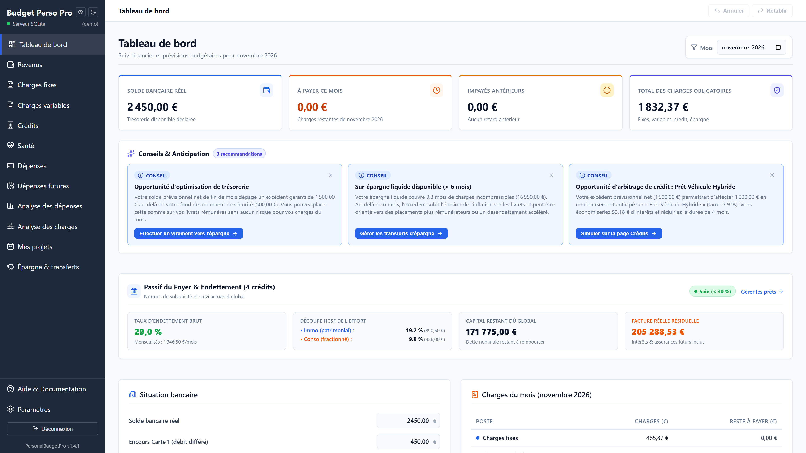
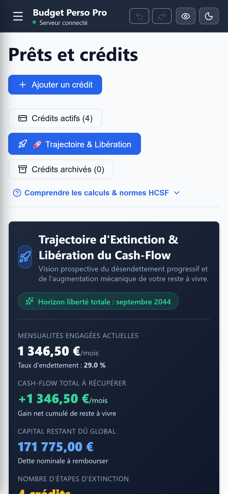
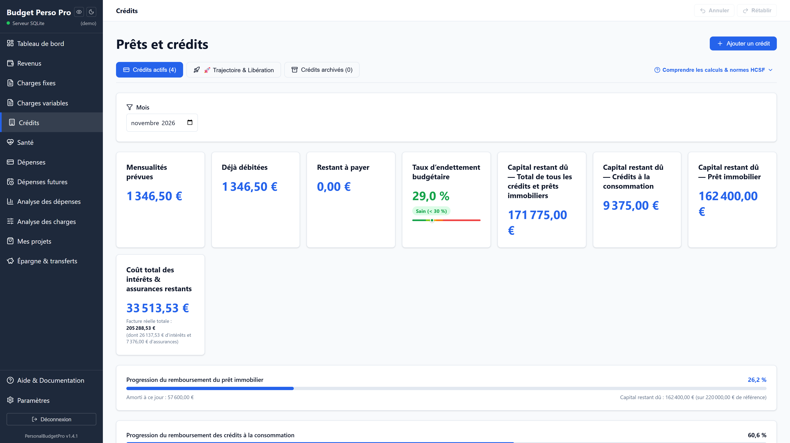
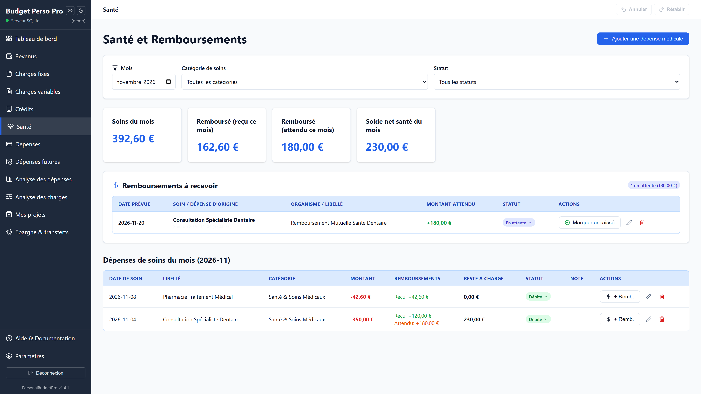
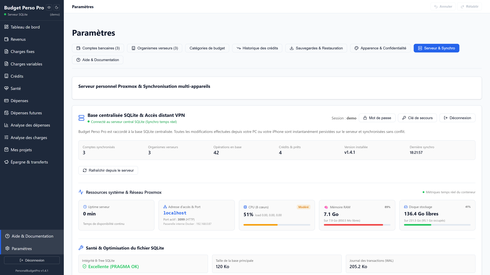

# Personal Budget Pro (v1.4.2)

[](LICENSE)
[](https://nodejs.org/)
[](https://sqlite.org/)
[](package.json)
[](#2-stack-technique--architecture)

**Personal Budget Pro** est une application web auto-hébergée (*self-hosted*) de gestion budgétaire, d'anticipation de trésorerie (*cash-flow*) et de pilotage d'endettement.

Conçue pour fonctionner sur serveur domestique ou conteneur Proxmox VE (LXC), elle privilégie la sobriété des ressources (< 60 Mo de RAM au repos), la vélocité native de Node.js 24 (`node:sqlite` en mode WAL) et la souveraineté totale des données financières (aucun cloud tiers, aucun abonnement, aucune télémétrie).

---

## Aperçu de l'Interface

### Tableau de bord & Anticipation de Trésorerie
Vue consolidée avec indicateurs de solde réel vs prévisionnel, sentinelles prédictives en temps réel et décomposition graphique des flux.


### Pilotage des Prêts & Trajectoire de Désendettement
Suivi des normes HCSF, décomposition du coût réel de la dette (capital utile vs perte sèche) et frise chronologique d'extinction avec calcul du cash-flow récupéré (+XX €/mois).

| Trajectoire Mobile (Frise des Victoires) | Crédits Actifs (Desktop) |
| :---: | :---: |
|  |  |

### Cycle des Soins Médicaux & Restes à Charge
Gestion à trois temps des dépenses de santé : avance de frais, pointage des remboursements décorrélés (Sécurité Sociale et Mutuelle) et suivi des créances en attente.


### Administration Système & Métriques SQLite WAL
Console d'infrastructure affichant l'état du runtime Node.js 24, le contrôle B-Tree SQLite (`PRAGMA integrity_check`), la rotation des journaux et les sauvegardes automatiques.


---

## 1. Fonctionnalités Clés

* **Double Lecture de Trésorerie (La Règle d'Or Bancaire) :**  
  Dissociation stricte entre le solde physique en banque à l'instant T (anti-découvert immédiat) et l'atterrissage net de fin de mois après déduction des engagements récurrents et des cartes à débit différé.
* **Moteur d'Amortissement Actuariel & Normes HCSF :**  
  Décomposition exacte de chaque mensualité (Capital amorti + Intérêts + Assurance emprunteur). Calcul de la perte sèche résiduelle banque et suivi de l'effort patrimonial (Immobilier) vs fractionné (Consommation).
* **Frise Chronologique « Trajectoire & Libération » :**  
  Planification ordonnée de l'extinction des dettes avec cumul dynamique du cash-flow permanent restitué au foyer et projection continue du taux d'endettement jusqu'au désendettement total.
* **Moteur Flash Insights (11 Sentinelles en Mémoire) :**  
  Audit heuristique instantané (< 2 ms) : détection de vulnérabilité conso (> 15 % des revenus), compte à rebours de fin de crédit (≤ 3 mois), surveillance des dérives de charges et actes médicaux sans remboursement sous 45 jours.
* **Dépenses Courantes & Pointage au Centime :**  
  Suivi des opérations au fil de l'eau avec typologie des moyens de paiement (carte, virement, prélèvement, chèque avec préservation des zéros initiaux ex: `001482`).
* **Mes Projets (Wishlist Priorisée) :**  
  Planification d'achats futurs avec degré d'urgence (`urgent`, `medium`, `low`), date cible et enveloppe estimée, sans impacter les comptes bancaires actifs.
* **Mode Discret & Thèmes :**  
  Floutage instantané des montants sensibles pour consultation sur écran partagé ou en lieu public. Support des thèmes sombre et clair.

---

## 2. Stack Technique & Architecture

* **Backend :** Node.js 24 (LTS Alpine), architecture native sans framework lourd (serveur HTTP natif, requêtes SQL préparées synchrones via `node:sqlite`).
* **Base de données :** SQLite 3 en mode **WAL** (`Write-Ahead Logging`, `PRAGMA synchronous = NORMAL`, cache optimisé à 16 Mo).
* **Frontend :** SPA React 19, TypeScript strict, Vite, Tailwind CSS, Lucide Icons, Recharts v3.
* **Sécurité :** Hachage des mots de passe par `scrypt` (dérivation de clé résistante aux attaques matérielles) couplé à une clé de secours déterministe (`BUDGET-XXXX-XXXX-XXXX`).
* **Empreinte système :** Moins de 60 Mo de RAM consommée au repos, CPU négligeable (< 0,1 % sur Proxmox LXC).
* **Qualité & Tests :** 65 suites de tests automatisées, 627 tests Vitest passants (100 %).

---

## 3. Déploiement Rapide

### Option A : Docker Compose (Recommandé)

```bash
# 1. Cloner le dépôt
git clone https://github.com/yanfrance-droid/Budget-Perso-Pro.git
cd Budget-Perso-Pro

# 2. Configurer l'environnement
cp .env.example .env

# 3. Démarrer le conteneur
docker compose up -d --build

# 4. Vérifier les journaux
docker compose logs -f
```

L'application est accessible sur `http://localhost:3001` (ou `http://IP_SERVEUR:3001`).  
Au premier chargement, configurez votre mot de passe administrateur local et conservez votre clé de secours.

### Option B : Script d'Exploitation pour Hôtes Linux / Proxmox VE

Pour les déploiements directs sur Debian / Ubuntu ou conteneur Proxmox LXC, un script d'exploitation automatisé en Bash strict est fourni : [`gestion-personal-budget-pro.sh`](gestion-personal-budget-pro.sh).

```bash
chmod +x gestion-personal-budget-pro.sh
sudo ./gestion-personal-budget-pro.sh
```

**Actions gérées par le script :**
* Installation et initialisation automatique de l'environnement.
* Mise à jour sécurisée avec contrôle d'intégrité préalable (`PRAGMA integrity_check`), sauvegarde physique à chaud (`VACUUM INTO`) et reconstruction Docker.
* Restauration certifiée de base SQLite sans risque d'incohérence WAL.

---

## 4. Persistance & Sauvegardes

Deux volumes locaux suffisent à pérenniser l'ensemble des données :
* `./data:/app/data` : Contient la base de données SQLite `budget.db` et le dossier des sauvegardes automatiques (`data/backups/`).
* `./logs:/app/logs` : Contient les journaux tournants de maintenance technique.

Les exports complets au format classeur **Microsoft Excel** / **LibreOffice Calc** (`.xlsx`) et dumps SQLite bruts (`.db`) sont directement téléchargeables depuis la rubrique *Paramètres > Sauvegardes*.

---

## 5. Licence & Avertissement

Ce projet est distribué sous licence libre **MIT** ([`LICENSE`](LICENSE)). Il est fourni en l'état (*As-Is*) pour un usage personnel et la communauté auto-hébergement. L'utilisateur demeure responsable de la sauvegarde et de la sécurisation de ses données d'infrastructure.
